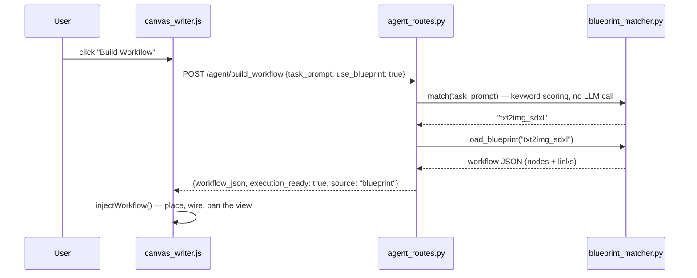
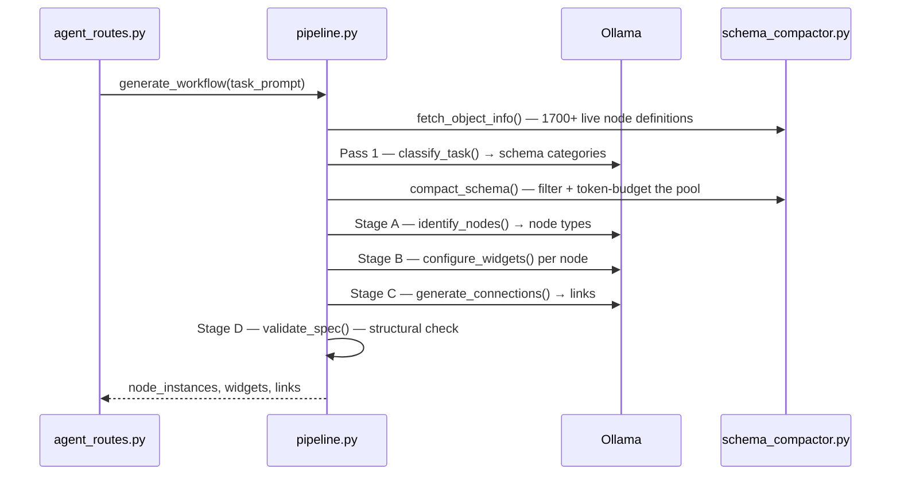

# Comfy Agent — Architecture & Build Log

A meta-node that reads natural language and builds ComfyUI workflows directly
on the canvas — and answers questions about your specific installation. This
document explains what it is, how it's put together, and how it actually came
to work — including the real bugs found by running it against a live ComfyUI +
Ollama install, not just static review.

---

## 1. What this is

Comfy Agent is not a sidebar and not an external tool. It is a ComfyUI custom
node — `ComfyAgent` — that lives on the canvas like any other node. It has two
modes, sharing one backend and one view of the live install:

- **BUILD** — click **Build Workflow** and it draws new nodes and wires
  connections around itself in real time. Its output is a workflow, not image
  data.
- **CHAT** — a conversation panel hosted in the node body (Section 11). It is
  not a generic chatbot bolted on: it answers from a live index of the nodes
  and model files *this* machine actually has, plus the current canvas and the
  last execution error.

BUILD does its work in three stages, corresponding to three jobs:

1. **Understand** — turn a natural-language `task_prompt` into a workflow
   intent.
2. **Reason** — decide which nodes are needed, how they connect, and what
   their widget values should be, validating every decision against the
   live ComfyUI install before committing to anything.
3. **Build** — draw the result on the canvas without overlapping existing
   nodes, wire the links, and report status back to the user.

The generation strategy is **blueprint-first**: an 8-template library covers
the common cases (txt2img, img2img, upscale, ControlNet, LoRA stacking, face
detailing, video) and is tried before anything else, because it's instant and
never hallucinates. Free-form generation — a four-stage LLM pipeline that can
build a workflow from scratch — is the fallback path for requests no
blueprint matches.

---

## 2. Why this is harder than it looks

Manually crafting a ComfyUI workflow requires knowing which of 1,700+
installed node types apply, what their exact input/output names are, and how
their types chain together — none of which an LLM should be trusted to recall
from memory. Two decisions follow from that:

- **The live `/object_info` endpoint is the only source of truth for node
  shapes.** No node's inputs, outputs, or types are ever answered from a
  model's memory.
- **No LLM ever emits raw workflow JSON.** It either selects a pre-validated
  blueprint and fills in the details, or its output is decomposed into four
  narrow, independently-validated stages (node selection, then widgets, then
  links, then a structural check) — never one big "write me a workflow"
  call.

The primary model is `qwen3.5:0.8b` — chosen for being already installed and
fast, but small enough that every design decision below exists specifically
to keep it from being asked more than it can reliably do in one call.

---

## 3. Architecture at a glance

```
ComfyUI (browser)                          ComfyUI (Python backend)
┌─────────────────────┐                    ┌──────────────────────────┐
│  ComfyAgent node     │  POST /agent/      │  agent_routes.py          │
│  (task_prompt, mode, │  build_workflow    │   ├─ blueprint_matcher    │
│   Build Workflow ▶)  ├───────────────────►│   │   (instant, no LLM)  │
│                      │                    │   └─ generation/pipeline │
│  js/agent_node_ui.js │◄───────────────────┤       (4-stage, Ollama)  │
│  js/canvas_writer.js │  workflow_json +   │                          │
│  (draws the result)  │  live WS progress  │                          │
│                      │                    │                          │
│  js/chat_panel.js    │  POST /agent/chat  │  chat_context.py          │
│  (CHAT mode panel)   ├───────────────────►│   └─ install_index.py     │
│                      │◄───────────────────┤       (semantic retrieval)│
│                      │  streamed tokens   │                          │
│                      │  (WS chat_token)   │  llm_client.py ─────────►│──► Ollama
└─────────────────────┘                    └──────────────────────────┘   (localhost:11434)
                                                        ▲
                                            /object_info │ /models
                                            (live install truth)
```

The JS side never talks to Ollama or the node registry directly — it calls
`/agent/build_workflow` and `/agent/chat` and renders what comes back. All
reasoning happens server-side in Python, which is what makes every stage
independently testable (and, as below, independently debuggable without a
browser).

---

## 4. Package structure

```
custom_nodes/comfy_agent/
├── __init__.py              registers via comfy_entrypoint, sets WEB_DIRECTORY
├── agent_node.py            the ComfyAgent node itself (V3 schema)
├── agent_routes.py          /agent/ping, /agent/health, /agent/build_workflow,
│                            /agent/chat
├── chat_context.py          CHAT system prompt: canvas + models + nodes + error
├── install_index.py         semantic index over all installed nodes + models
├── llm_client.py            async Ollama client, retry + fallback escalation
│                            (generate_json, chat_stream, embed)
├── config.py                every model name / timeout / budget, in one place
├── knowledge/
│   ├── schema_compactor.py  /object_info fetch + category filtering + token budget
│   ├── type_validator.py    type-safe link validation (case-normalized)
│   └── blueprint_matcher.py keyword → blueprint selection, blueprint loading
├── generation/
│   ├── classify.py          Pass 1 — which schema categories does this need
│   ├── stage_a_identify.py  Stage A — which node types
│   ├── stage_b_configure.py Stage B — widget values for each node
│   ├── stage_c_connect.py   Stage C — links between nodes
│   ├── stage_d_validate.py  Stage D — structural validation before it ships
│   ├── stage_m_modify.py    Stage M — validated diff against the live canvas
│   └── pipeline.py          orchestrates Pass 1 + Stages A–D, streams progress
├── blueprint_defs/          8 pre-authored workflow templates (JSON)
└── js/
    ├── agent_node_ui.js     Build button, status widget, mode switching,
    │                        WS progress listener, execution_error capture
    ├── chat_panel.js        CHAT DOM panel: scrollback, input, token streaming
    ├── canvas_writer.js     overlap-aware placement, node/link injection
    ├── progress_listener.js WebSocket → status widget / chat token wiring
    └── agent_style.css      CHAT panel styling (theme-aware)
```

`install_index.cache.json` also appears here at runtime (~18 MB of node
embeddings). It is generated, gitignored, and rebuilt automatically whenever
the installed node set changes.

---

## 5. Request lifecycle

### 5a. Blueprint path (the fast, reliable path)



No Ollama call happens on this path at all — it's why blueprint mode works
even with Ollama offline, and why it's instant.

### 5b. Free-form path (the fallback, when no blueprint matches)



Every stage's LLM output is treated as a *proposal*: Stage A's node names are
checked against the real `/object_info` keys, Stage C's links are
independently re-validated by `type_validator.py`, and Stage D can still
reject the whole thing before it ever reaches the browser.

### 5c. CHAT path (no canvas writes)

```mermaid
sequenceDiagram
    participant JS as chat_panel.js
    participant R as agent_routes.py
    participant CC as chat_context.py
    participant IX as install_index.py
    participant O as Ollama
    JS->>R: POST /agent/chat {messages, graph, last_error}
    R->>CC: build_system_prompt(question, graph, last_error)
    CC->>IX: build() — cached; embeds 1767 nodes on first run
    CC->>IX: search(question) — top-K by cosine + name bonus
    CC->>IX: render_model_inventory() — installed weights
    CC-->>R: system prompt (~1300 tokens)
    R->>O: chat_stream() — no format constraint
    O-->>R: tokens
    R-->>JS: WS comfy_agent.chat_token (per token, routed by chat_id)
    R-->>JS: HTTP {reply} — full text, for clients that missed the stream
```

Unlike BUILD, nothing here touches the canvas: CHAT reads the graph but never
writes to it, so a question can never modify a workflow.

---

## 6. The knowledge layer

**`schema_compactor.py`** turns the live `/object_info` payload — 1,717 nodes
on a typical install — into something a small model can actually hold in
context. It buckets every node into categories (`loaders`, `sampling`,
`latent`, `conditioning`, `image`, `upscaling`, `controlnet`, `video`,
`mask`, `custom`) by keyword match, then filters to only the categories a
given request needs, and caps the result by an estimated character budget
tied to `config.PASS2_MAX_SCHEMA_TOKENS` (2500 tokens by default) — not just
a raw node count, since node entries vary wildly in size.

**`type_validator.py`** normalizes every type string to uppercase before
comparing (`"model"` → `"MODEL"`), so link validation never breaks on a case
mismatch between what an LLM emits and what `/object_info` reports. It's the
single gate every proposed link passes through before being accepted.

**`blueprint_matcher.py`** scores a `task_prompt` against each blueprint's
trigger keywords and picks the best match. Blueprint files live in
`blueprint_defs/` and are loaded directly by Python file I/O — deliberately
*not* through ComfyUI's own native "Global Subgraph" feature, which expects a
different, undocumented internal format (see §9).

**`install_index.py`** solves the same "too much registry, too little context"
problem as `schema_compactor.py`, but for a different consumer and with a
different strategy. The compactor serves BUILD, where the request category is
known up front, so *keyword bucketing* is enough. CHAT has no such hint — a
user may ask about any of 1767 node types in any phrasing — so the index
embeds every node once and retrieves by *semantic similarity* per question.
It also carries the installed-model inventory, which the build path never
needed. Full details in §11.

---

## 7. The four-stage generation pipeline

Single-pass "write me a whole workflow" generation is where small models
fail hardest, so free-form generation is split into four narrow calls, each
asking for the least possible output:

| Stage | Asks the model for | Nothing else |
|---|---|---|
| A — Identify | a bare JSON array of node class_type names | no widgets, no links |
| B — Configure | one node's widget values, one call per node | no other nodes in scope |
| C — Connect | links between already-validated node instances | no widget concerns |
| D — Validate | (no LLM call) — structural check: any nodes? any links? fully disconnected? | — |

Every stage uses Ollama's `format` parameter — a JSON-schema grammar
constraint, not a hinted instruction — so the model's output is structurally
forced to match, not just asked nicely to match.

### Escalation: when "valid JSON" still isn't a good answer

The retry logic (`llm_client.generate_json_with_fallback`) only escalates
from the primary model (`qwen3.5:0.8b`) to the fallback (`qwen3.5:9b`) when a
call fails outright — bad HTTP, unparseable JSON. But a small model's most
common failure mode isn't a crash: it's returning perfectly valid JSON that's
still wrong — two nodes when six are needed, a hallucinated widget value, a
link with the whole input list copied in as one string.

Stages A and C each carry an extra check for exactly this: if the primary
model's *validated* result is implausibly sparse (fewer than 5 nodes for
Stage A; fewer links than a connected graph needs for Stage C), it silently
tries the fallback model once more and keeps whichever result is more
complete. This is what actually made free-form generation reliable — not the
retry-on-error path, but this good-enough-output check.

---

## 8. The frontend

`agent_node_ui.js` renders the node's Build Workflow button and a read-only
status widget, and wires up a WebSocket listener so the status widget
updates live as the backend streams progress
(`"Fetching node registry..."` → `"Identifying nodes..."` → `"Done — built N
nodes, M links"`).

`canvas_writer.js` is where the actual drawing happens:

- `computeSpecFootprint()` measures how much canvas space the incoming spec
  actually needs (a blueprint's real bounding box, or an estimate for
  free-form specs), so `findFreeZone()` can check the *whole* footprint
  against existing nodes — not a fixed placeholder box that a big blueprint
  could still overlap.
- `injectBlueprint()` / `injectFreeForm()` call `LiteGraph.createNode()` for
  each node, wrapped in try/catch so one failed node type doesn't take down
  the whole build, then wire links via `node.connect(fromSlot, toNode,
  toSlot)`.
- `maybeWrapSubgraph()` attempts to fold builds over 6 nodes into a single
  SubgraphNode, falling back to a flat node list if the wrap throws (which,
  on this ComfyUI version, it currently does — caught and handled, not a
  blocker).
- After injection, `injectWorkflow()` pans the view to the new nodes via
  `app.canvas.centerOnNode()` — without this, a successful build could land
  entirely outside the current viewport and look indistinguishable from a
  silent failure.

`chat_panel.js` hosts CHAT mode as a real DOM widget (`node.addDOMWidget`)
rather than a LiteGraph text widget, since the panel needs scrollback,
streaming updates, and a focusable input. Four details are load-bearing:

- **Keystrokes are stopped from propagating.** Without
  `stopPropagation()` on `keydown`/`keyup`/`keypress`, typing in the box also
  fires LiteGraph's canvas shortcuts — pressing Delete while composing a
  question would delete the selected node.
- **Mode switching hides the DOM widget by size, not by flag.** LiteGraph
  honours `hidden` for native widgets but not for DOM ones, so `applyMode()`
  sets `display: none` *and* overrides `computeSize` to collapse the row.
- **History persists via `onSerialize`/`onConfigure`**, not through a widget
  value — serializing a DOM node into the workflow JSON would corrupt the save.
- **Execution errors are captured globally.** An `execution_error` listener
  stores the traceback on every agent node, so "why did that fail?" needs no
  copy-paste from the user.

`agent_style.css` is linked in explicitly by `agent_node_ui.js`: ComfyUI serves
`WEB_DIRECTORY` statically but only auto-loads `.js` from it, so a stylesheet
sitting there is inert until something injects a `<link>`.

---

## 9. What broke, and what actually fixed it

This is the part that only came from running the thing against a live
ComfyUI Desktop install and local Ollama, not from reading the code. Ordered
by how deep in the stack each one was hiding:

**The loader never ran our V3 node.** `nodes.py`'s custom-node loader checks
for `NODE_CLASS_MAPPINGS` *before* `comfy_entrypoint`, and short-circuits the
moment it finds one — even an empty dict, since the check is `is not None`,
not truthiness. `__init__.py` had exported both. Fix: export `comfy_entrypoint`
only.

**A successful build looked identical to a silent failure.** `findFreeZone`
checked a fixed 300×200 box no matter how many nodes the spec contained, and
nothing panned the viewport afterward. A 7-node blueprint could land far
outside the visible canvas — or partially overlap existing nodes — with zero
visible change. Fixed by sizing the free-zone check to the real spec
footprint and auto-panning to the result.

**Ollama's thinking models silently ate every free-form response.**
`qwen3.5:0.8b` is a "thinking" model — with `format` schema constraints on,
it wrote the actual JSON into Ollama's separate `thinking` field and left
`response` empty. `llm_client.py` only ever parsed `response`, so every
single free-form call failed with "not valid JSON: " (an empty string),
regardless of prompt quality. This looked like *everything* was broken. Fix:
send `think: false`, and parse `thinking` as a defensive fallback.

**Pass 1 classification silently starved the candidate pool.** Direct
testing showed the classifier regularly returned `['sampling']` only for a
plain txt2img request — dropping `loaders` and `conditioning` entirely. That
meant `CheckpointLoaderSimple` and `CLIPTextEncode` were never even *in* the
list Stage A picked from, no matter how good Stage A's own prompt was. This
was the actual root cause behind persistently broken free-form results,
found only by logging Pass 1's raw output across repeated runs. Fix:
`classify.py` now always unions the model's answer with a fixed core
category set, and Pass 1 only adds *specialized* categories on top — a
restrictive classifier that can silently exclude essentials is worse than
the token-bloat problem the two-pass split was meant to solve.

**Stage C was connecting nodes blind.** Its prompt only ever listed
`instance_id: class_type` — the `schema` parameter it received was used
*only* for validating the model's answer afterward, never shown to the model
beforehand. It had no way to know KSampler's inputs were even called
`model`/`positive`/`negative`/`latent_image`. Fix: the prompt now lists each
instance's real input/output names plus a worked example link.

**A broken result could still report success.** Stage D collected "orphan
node" warnings into an `errors` list but the `valid` flag never actually
checked it — a completely disconnected multi-node result (0 links between 6
nodes) reported `execution_ready: true`. Fixed to treat a fully disconnected
multi-node graph as invalid, not a soft warning.

**Hallucinated widget values would have broken on canvas.** Stage B's
`_coerce` only type-converted INT/FLOAT/BOOLEAN — COMBO widgets (like
`sampler_name`, which is a fixed enum, not free text) passed straight
through unchecked, so a value like `"SDXL"` for `sampler_name` would have
been written directly onto a real node. Fixed to validate COMBO values
against the node's real allowed options and drop anything that doesn't
match, and to tell the model what those options actually are instead of a
bare widget name.

**Config that was never wired up.** `PASS2_MAX_SCHEMA_TOKENS` existed in
`config.py` from the start but nothing ever enforced it — the real candidate
pool for a common category set measured ~3,300 tokens, already past the
declared 2,500-token budget, before Pass 2 even added the task prompt. Fixed
by tying `schema_compactor.compact_schema`'s truncation to that budget for
real.

**Ollama's own subgraph feature, misapplied.** Naming the blueprint folder
`subgraphs/` made ComfyUI's frontend try to auto-discover and load them as
native "Global Subgraphs" on every page load — a feature this project
doesn't use, since blueprints are read directly by Python. That produced 8
console errors every session. Fixed by renaming the folder to
`blueprint_defs/`, which nothing else auto-scans.

**A fallback model that didn't exist.** `config.FALLBACK_MODEL` was set to
`llama3.1:8b`, which was never pulled on this machine's Ollama — so any
escalation attempt 404'd instead of retrying on a working model. Fixed to
point at `qwen3.5:9b`, which was actually installed.

**Two copies of the node, and the wrong one was loading.** After adding CHAT,
the new `mode` option never appeared in the UI. The schema on disk was correct
and the server had been restarted — but ComfyUI loads from
`ComfyUI/custom_nodes/comfy_agent`, while the git repo being edited lived
elsewhere on another drive. The running install was a snapshot **weeks stale**,
missing not just CHAT but several of the fixes above. Diagnosed by comparing
the live `/object_info/ComfyAgent` response against the file on disk — the
server is the authority on what it actually loaded, not the editor.

**A backup directory registered itself as the same node.** The fix for the
above was a copy, with the old version backed up to
`custom_nodes/comfy_agent.backup-<date>` — *inside* the directory ComfyUI
scans. ComfyUI keys on `node_id`, not folder name, so both directories
registered `ComfyAgent` and the stale backup won, silently reverting the
schema again. Backups must live outside `custom_nodes/`.

**Retrieval ranked confidently and wrongly.** Covered in Section 11: an exact
node name losing to its own variants, and a filler verb ("make") outranking
genuine semantic relevance. Both looked fine in code review and only surfaced
when queried against the real 1767-node registry.

Each of these was found the same way: run the actual thing, read the actual
error, trace it to its actual cause — not by guessing from the code. The last
three are worth generalising: **the running system is the authority on its own
state**, and where it loads from is as much a fact to verify as what the code
says.

---

## 10. Known limitation, honestly stated

Free-form generation quality is bounded by the 0.8B primary model's
reasoning, exactly as anticipated going in. Even after every fix above,
Stage C sometimes still leaves one plausible link unconnected (most often
`VAEDecode → SaveImage`) on some runs — the escalation logic catches the
*worst* failures (empty node lists, zero links, garbage widget values) but
doesn't guarantee a fully complete graph on every single call. This isn't a
bug to chase further; it's the actual, measured ceiling of a sub-1B model,
and it's exactly why blueprint mode — which has no such ceiling, since it's
pre-authored — is the primary path, not the fallback.

The same ceiling applies to CHAT, and it is worth separating two things that
are easy to conflate. **Grounding is accurate**: retrieval was verified against
the real registry, and the model is given real installed node names and real
model filenames rather than recalling them. **Prose quality is not guaranteed**:
`qwen3.5-0.8b-comfyagent` is fine-tuned for workflow *generation*, not
explanation, and its answers can be loose even when the facts in front of it
are right. Pointing `PRIMARY_MODEL` at `qwen3.5:4b` or `:9b` measurably
improves explanations at some VRAM cost.

Retrieval also has **no formal recall benchmark**. It was tuned against
hand-checked queries, and the failures in Section 11 were found by inspection
rather than by a metric suite — so its accuracy on phrasings nobody tried is
genuinely unknown.

---

## 11. CHAT mode and the install index

### The constraint that shapes everything

CHAT answers questions about ComfyUI, the user's graph, and *this specific
installation*. The obvious implementation — hand the model the node registry —
is impossible here:

| | |
|---|---|
| `/object_info` on this install | **~2.7 MB, 1767 node types** |
| As tokens | **~680,000** |
| `OLLAMA_CHAT_NUM_CTX` | 65,536 |
| Ratio | **~10x too large** |

Raising the context window does not fix this. Even at the model's 262k
architectural maximum you would hold under 40% of the registry with nothing
left for the question; the KV cache at that size exceeds the 8 GB card this was
built on; and a sub-1B model loses the question in the middle long before any
of those ceilings. So the registry is **indexed and retrieved**, never dumped.

### How retrieval works

`install_index.py` embeds every node once with `nomic-embed-text`, then each
question retrieves its top-K matches (`CHAT_RETRIEVAL_TOP_K`, default 24).
Measured on a real question, the assembled prompt is **~1,300 tokens — about 2%
of the chat window** while covering an install that would otherwise need 680k.

Two properties keep it usable:

- **Cached to disk**, keyed by a SHA-256 fingerprint of the sorted node-type
  names. The ~22s build happens once and survives restarts; installing or
  removing a node pack invalidates it automatically. A server restart does not.
- **Degrades instead of failing.** If Ollama or the embed model is unavailable,
  retrieval falls back to keyword scoring. A chat with worse node lookup beats
  a chat that is down — and this also covers the first run, before the index
  has warmed.

### Ranking: three signals, each earned by a real failure

Pure vector similarity was not good enough. Every term below was added to fix a
specific misranking observed against this install's real registry:

| Signal | Failure it fixes |
|---|---|
| Semantic cosine | baseline — finds paraphrases ("remove the background" → `RemoveBackground`) |
| Exact-name bonus | "what does KSampler do" returned `KSamplerAdvanced`, `KSamplerProvider`, `KSampler (Efficient)` — but **not `KSampler`**, because longer descriptive text scores higher |
| Stopword exclusion | the name bonus fired on filler verbs: "how do I **make** faces look better?" ranked `MakeTrainingDataset` (1.035) above `FaceDetailer` (0.641) purely on "make" |

After the fixes, `FaceDetailer` ranks **#1** for that query and `KSampler`
ranks #1 for its own.

Two text-normalisation details matter as much as the scoring:

- **CamelCase is split before embedding** (`FaceDetailer` → `Face Detailer`).
  Embedders tokenize CamelCase poorly, and node names carry most of the meaning
  here — `FaceDetailer`'s own description never contains the word "face".
- **Query plurals are singularised.** Users type "faces"; node names say
  `Face`. Without this the exact word the user cared about scores zero on the
  name. This one was caught by a unit test, not by inspection.

### Model inventory

Installed weights are read live from `/models`, so "what checkpoints do I have?"
is answered from disk rather than memory. Two filters are load-bearing:

- **Folder denylist.** `/models/custom_nodes` alone returned **1400 entries** —
  `.editorconfig`, `.eslintrc.cjs`, GitHub issue templates. Unfiltered, source
  files crowded the real checkpoints out of the prompt.
- **Extension allowlist.** Only weight extensions are listed, so the model
  cannot offer a linter config as though it were a usable checkpoint.

### Why chat does not reuse the generation path

`llm_client.chat_stream()` deliberately sends **no** `format` constraint. Every
other call in that module is JSON-schema-constrained, which is correct for
building a graph and exactly wrong for conversation — a schema-constrained
model answers "why is my image black?" with a JSON object. Chat also runs at
`temperature 0.6` rather than the pipeline's 0.1, since near-greedy decoding
makes prose repetitive and stilted.

Tokens stream over the `comfy_agent.chat_token` WS event, routed by `chat_id`
exactly as builds are routed by `build_id` — without that, two agent nodes on
one canvas splice their replies into each other. The HTTP response also carries
the full reply, so a client that missed the stream still renders.

---

## 12. Configuration reference

All tunable values live in `config.py`:

| Setting | Value | Why |
|---|---|---|
| `PRIMARY_MODEL` | `qwen3.5:0.8b` | fast, already installed, low resource footprint |
| `FALLBACK_MODEL` | `qwen3.5:9b` | escalation target when the primary's output is invalid or implausibly sparse |
| `STAGE_RETRY_CAP` | 1 | same-model retries before escalating |
| `PASS2_MAX_SCHEMA_TOKENS` | 2500 | schema block budget handed to Stage A |
| `SUBGRAPH_WRAP_THRESHOLD` | 6 | node count above which a build attempts subgraph wrapping |
| `OLLAMA_GENERATE_TIMEOUT_SECONDS` | 60 | per-call timeout |
| `ALLOW_NETWORK` | `False` | routes reject non-localhost requests by default |
| `OLLAMA_NUM_CTX` | 8192 | context for the BUILD pipeline |
| `OLLAMA_CHAT_NUM_CTX` | 65536 | context for CHAT — **KV cache grows linearly with this (~3-4 GB here); lower it first if a Flux/SDXL run OOMs while chatting** |
| `EMBED_MODEL` | `nomic-embed-text` | embeds the install index; absent → keyword-only retrieval |
| `CHAT_RETRIEVAL_TOP_K` | 24 | nodes injected per question — the limit is answer quality, not context |
| `CHAT_MAX_GRAPH_CHARS` | 6000 | canvas snapshot budget before it degrades to a node-type summary |
| `MODEL_FOLDER_DENYLIST` | `custom_nodes`, … | folders that hold source code, not weights |

---

## 13. Extending it

**Add a blueprint:** build the workflow in ComfyUI's own canvas, export it as
workflow JSON, drop it in `blueprint_defs/<name>.json`, and add its trigger
keywords to `BLUEPRINT_KEYWORDS` in `blueprint_matcher.py`. No Python
changes needed.

**Add a mode:** `EXPLAIN`/`DEBUG`/`SUGGEST` are wired into
`agent_routes.py`'s dispatch but currently return "not implemented yet" —
each needs a handler function following the same shape as `_handle_build`.
The canvas state they need is not missing: the frontend serializes the graph
on every CHAT and MODIFY request, so a new handler can reuse that rather than
rebuilding it.

`MODIFY` is implemented and is the worked example to copy. It follows a
different shape from `_handle_build` on purpose: `generation/stage_m_modify.py`
returns a *diff* (`add_nodes` / `remove_node_ids` / `set_widgets`) validated
against the live canvas ids and the installed registry, and the response
carries `diff` instead of a `workflow_json` spec. The frontend snapshots the
graph (`canvas_writer.snapshotGraph`) before calling `applyDiff`, which is
what makes the edit undoable — mandatory for any mode that mutates existing
user work rather than adding to empty space. Note that `CHAT` is dispatched by its own
route (`/agent/chat`) rather than through `build_workflow`, because the build
response shape cannot carry a token stream.

**Extend the install index:** `install_index.py` builds its searchable text in
`_describe_node()` and its prompt-facing line in `schema_line()`. Adding a
signal (say, which custom-node pack a node came from) means editing
`_describe_node` and forcing one rebuild — the cache fingerprint only tracks
node *names*, so a change to the description format needs
`build(force=True)` or deleting `install_index.cache.json`.
